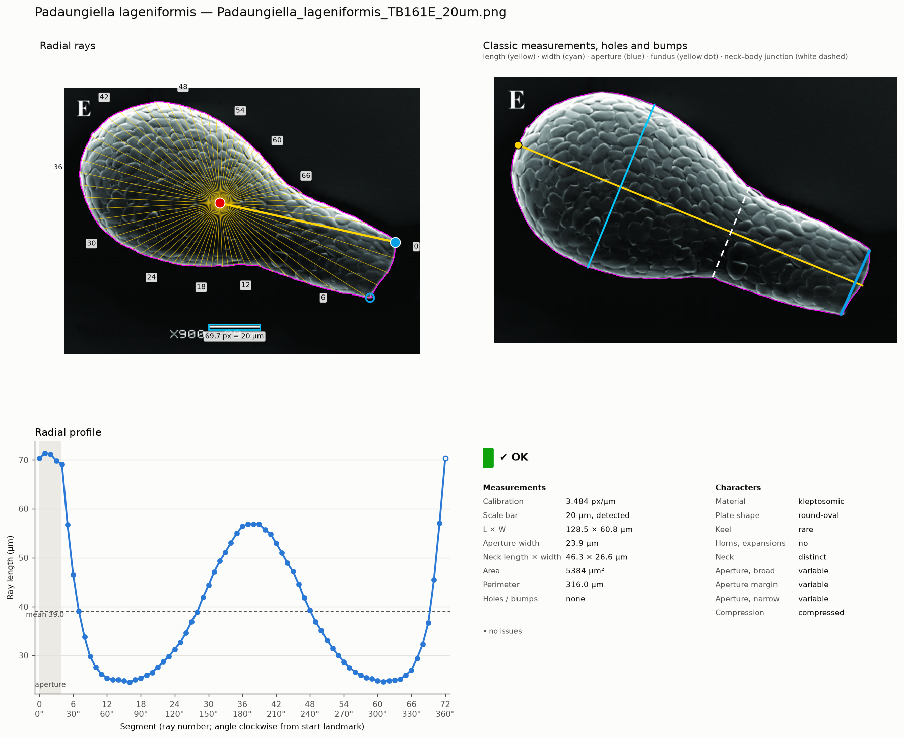

# TA-Morpho: shape measurement of testate amoeba tests

[](https://github.com/DavidSinger85/TA-Morpho/actions/workflows/tests.yml)
[](LICENSE)

TA-Morpho measures the shape of testate amoeba tests (shells) from microscope
pictures (light microscopy, SEM) or drawings, one test per picture. It finds
the scale bar, the outline of the test and its aperture, and measures:

- the **classic measurements** of the literature along the oral–aboral axis:
  length, width, aperture width, neck length and width, and their ratios, with
  area, perimeter, circularity, solidity and Feret diameters;
- a **radial profile**: the distance from the centroid to the outline every 5°,
  clockwise from an aperture corner;
- an **outline of 250 points** anchored on the two aperture corners and the
  fundus (the end of the test opposite the aperture), exported as landmarks and semilandmarks for **geometric
  morphometrics** (tpsDig, geomorph);
- **holes and bumps** of the outline, added by hand and measured;
- the **diagnostic characters** of the genus (material, plates, pores, keel,
  horns, neck, aperture, compression, fundus), filled in from the monograph
  of the hyalospheniids when the genus is known, and editable per specimen.

Every specimen gets a figure for visual checking and a status: `ok`, `check`
(look at the figure) or `failed`. Nothing is guessed silently: a value that
cannot be measured is left empty, and when a default is used (for example the
25 µm bar length when the file name gives none) the specimen is flagged. Every
correction made by hand is recorded with the results.

**Scope.** The method was developed and tested on the hyalospheniids
(*Hyalosphenia*, *Nebela*, *Apodera*, *Quadrulella*…): flattened, bilaterally
symmetric tests seen in broad view, with a terminal aperture. Other groups are
measured too, but the method was not tuned or tested on them: check every
figure.

**Why TA-Morpho.** Testate amoeba tests are usually measured by hand
(length, width, aperture) in image programs such as ImageJ/Fiji, and their
outline shape is studied with general tools: tpsDig to place landmarks by
hand, Momocs or geomorph in R once outlines or landmarks exist. TA-Morpho joins
these steps for this group: it finds the outline, the aperture and the
oral–aboral axis itself, takes the classic measurements as the testate amoeba
literature defines them, and exports outlines anchored on homologous points,
ready for geomorph. Every value can be checked on a figure and corrected by
hand, and the corrections stay visible in the results.


*Padaungiella lageniformis*, SEM picture from Todorov & Bankov (2019), CC BY 4.0 ([sources](data/validation/SOURCES.md)).

## Installation

**Desktop program (no programming needed).** Installers for Windows and macOS
are on the [Releases](https://github.com/DavidSinger85/TA-Morpho/releases)
page. The [user guide](docs/USER_GUIDE.md) explains the installation and the
program step by step.

**From source** (Python 3.11 or later). Get the code, then install it with
conda or pip:
```bash
git clone https://github.com/DavidSinger85/TA-Morpho.git
cd TA-Morpho
```
With conda:
```bash
conda env create -f environment.yml      # the exact versions the tests pass with
conda activate ta-morpho
```
or with pip:
```bash
python3.11 -m venv .venv
source .venv/bin/activate                # Windows: .venv\Scripts\activate
pip install -e ".[gui,test]"
```
This installs two commands: `ta-morpho` (command line) and `ta-morpho-gui`
(desktop program). On Linux and WSL the desktop program needs a few system
libraries; `ta-morpho-gui` prints the line that installs them when one is
missing.

## Use

**Desktop program:** `ta-morpho-gui`. Five tabs, in order: **Folders** (your
pictures and an output folder), **Settings** (usually the defaults),
**Run**, **Review** (check each specimen; correct the aperture corners, the
fundus, the scale bar or the outline on the picture, add holes and bumps, and
check the genus and its characters) and **Results**. See the [user guide](docs/USER_GUIDE.md).

**Command line:**
```bash
ta-morpho my_pictures/ -o my_results     # every picture of a folder
ta-morpho --export ...                   # also write the extra tables (profiles, geometric morphometrics)
ta-morpho --config my_settings.yaml ...  # other settings: only those you change (relative paths are read from that file's folder)
ta-morpho --help                         # all options
```
Each run replaces the results in the output folder.

**Corrections on the command line** are CSV tables named in the settings file
(`paths` and `calibration` sections; relative paths are read from the settings
file's folder). They are separate from the desktop program, which keeps its
corrections in its own output folder (`cells/<picture>.csv`): the command line
does not read those, and a results folder made on the command line cannot be
opened in the desktop program. A table that cannot be used (`;` separators, decimal commas, a
missing column, a picture listed twice) stops the run with the file named.

| Setting (default file) | Columns | Use |
|---|---|---|
| `paths.landmarks_csv` (`data/landmarks.csv`) | `image`, `x`, `y`, `end_x`, `end_y`, `fundus_x`, `fundus_y` | aperture corners (`x, y` and `end_x, end_y`) or a start point (`x, y` only), and the fundus; empty cells = automatic |
| `calibration.overrides_csv` (`data/calibration_overrides.csv`) | `image`, `px_per_um`, `bar_length_um` | the resolution of a picture whose bar is elsewhere (e.g. on the figure plate), or the length of its bar when the file name does not give it |
| `paths.review_csv` (`data/qc_review.csv`) | `image`, `note` | specimens checked by eye and accepted: `check` becomes `ok` |
| `paths.feature_corrections_csv` (`data/feature_corrections.csv`) | `image`, `action` (= `add`), `kind` (`hole` or `bump`), `x`, `y`, `radius_px`, `note` | holes and bumps to measure |
| `paths.characters_csv` (`data/characters.csv`) | `image`, `name`, `value` | genus, species or a character ([CHARACTERS.md](docs/CHARACTERS.md)) set by hand |
| `segmentation.masks_dir` (`data/masks/`) | `<picture>_mask.png` (white = test) | an outline drawn by hand; start from `--save-masks` |

Coordinates are in pixels of the original picture (x to the right, y
downwards).

**Pictures and file names.** One test per picture, in broad view; PNG, JPG or
TIFF; a horizontal scale bar in the picture, or the resolution given in a
calibration table. Name the files `Genus_species_<bar>um_<id>.png` (e.g.
`Nebela_collaris_20um_01.png`) or `<bar> Genus species.png` (e.g.
`20 Nebela collaris.png`): the genus, species and scale bar length are read
from the name. The bar length written with its unit (`20um`) can be anywhere
in the name; a bare number (`20`) is read as the bar length only at the start.
The other parts are read in order: genus, species, then the specimen id.

**Try it** on the 24 validation pictures of [`data/validation`](data/validation)
(13 hyalospheniid genera and *Argynnia*; light microscopy, SEM and drawings),
in the desktop program or with:
```bash
ta-morpho data/validation/images/Replicate_1 -o validation_results
```
How the program was validated against manual measurement (three replicates, with the data,
scripts and results): [`data/validation/README.md`](data/validation/README.md).

## Outputs

| File | Content |
|---|---|
| `summary.csv` | one row per specimen: status and messages, calibration, aperture and fundus positions, classic measurements and ratios, shape descriptors, holes and bumps, diagnostic characters (`ch_…`), and the radial profile (`r0` … `r355`, µm) |
| `cells/<picture>.png` | the figure of each specimen: outline, rays, centroid, aperture, length and width, values, status |
| `cells/<picture>.csv` | desktop program: the corrections made by hand on that specimen, if any |
| `cells/<picture>_mask.png` | desktop program: the outline drawn by hand on that specimen, if any (white = test) |
| `exports/` | on request: every ray of every specimen (`profiles_long.csv`), the 250-point outlines as distances from the centroid (`outline_profile.csv`) and as coordinates (`outline_coordinates.tps` and `outline_sliders.csv` for geomorph), the holes and bumps (`outline_features.csv`) |

Every column, with its unit and meaning: [`docs/DATA_DICTIONARY.md`](docs/DATA_DICTIONARY.md).

Geometric morphometrics in R:
```r
library(geomorph)
X   <- readland.tps("my_results/exports/outline_coordinates.tps", specID = "imageID")
sl  <- as.matrix(read.csv("my_results/exports/outline_sliders.csv"))
gpa <- gpagen(X, curves = sl, ProcD = FALSE)
```

## Documentation

- [`docs/USER_GUIDE.md`](docs/USER_GUIDE.md): the desktop program, step by step.
- [`docs/METHODS.md`](docs/METHODS.md): how each step works and why each setting has its value.
- [`docs/PARAMETERS.md`](docs/PARAMETERS.md): every setting of [`ta_morpho/config.yaml`](ta_morpho/config.yaml).
- [`docs/DATA_DICTIONARY.md`](docs/DATA_DICTIONARY.md): every output column.
- [`docs/CHARACTERS.md`](docs/CHARACTERS.md) and [`ta_morpho/genus_characters.csv`](ta_morpho/genus_characters.csv):
  the characters of the 14 hyalospheniid genera (Kosakyan et al. 2025), and how the program uses them.

## Tests
```bash
python -m pytest tests
```
The tests check that the 24 pictures of `data/validation` still give their
recorded results (a regression test: it shows that a change moved a result,
not that the result is right), drawn shapes of known size, and the desktop
program. They run on Linux, Windows and macOS for every change.

## Getting help and contributing

Questions and problems: the [Issues](https://github.com/DavidSinger85/TA-Morpho/issues)
page (the [user guide](docs/USER_GUIDE.md#5-questions) answers the common
ones). How to report a problem with a picture, and how to work on the code:
[`CONTRIBUTING.md`](CONTRIBUTING.md). Everyone taking part is expected to
follow the [code of conduct](CODE_OF_CONDUCT.md).

## Citation

Please cite the software ([`CITATION.cff`](CITATION.cff)); a citation with a
DOI will be given here once the software is archived.

## License

The code is under the MIT license ([`LICENSE`](LICENSE)). The pictures of
`data/validation` keep the licence of their source, given in
[`data/validation/SOURCES.md`](data/validation/SOURCES.md). This also applies
to [`docs/example_cell.png`](docs/example_cell.png) and the screenshots of the
user guide ([`docs/guide/`](docs/guide)), which show validation pictures
(mainly *Padaungiella lageniformis*, Todorov & Bankov 2019, CC BY 4.0).
