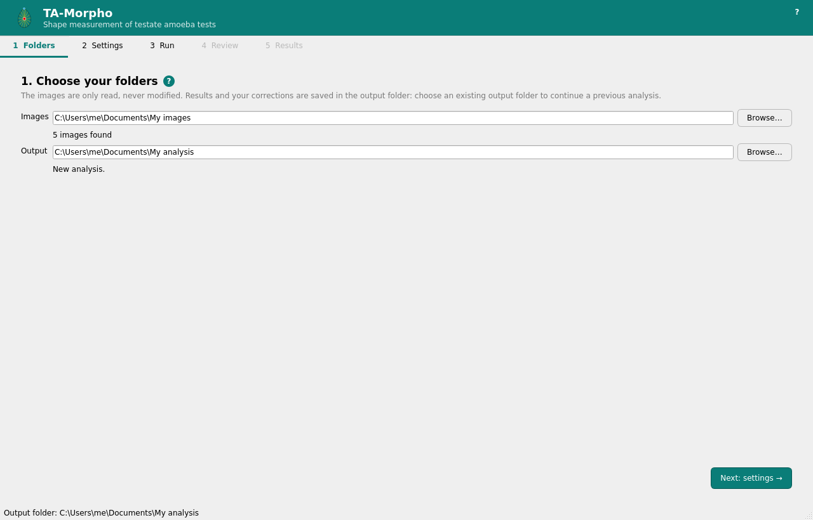
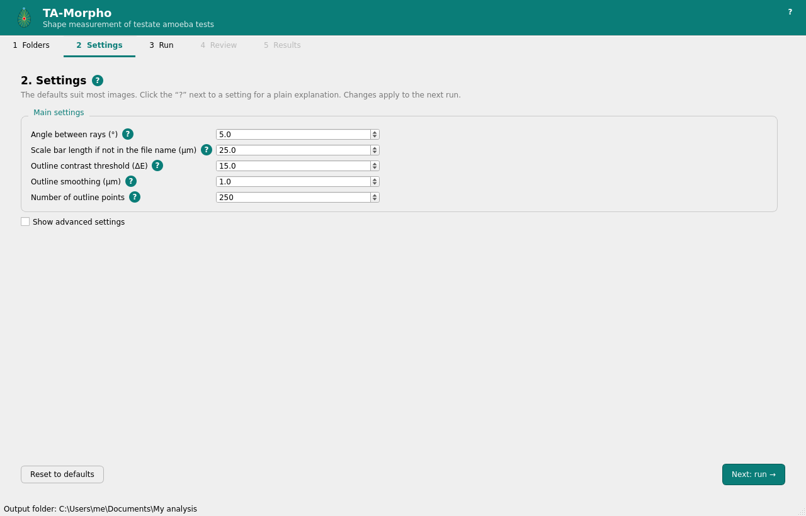
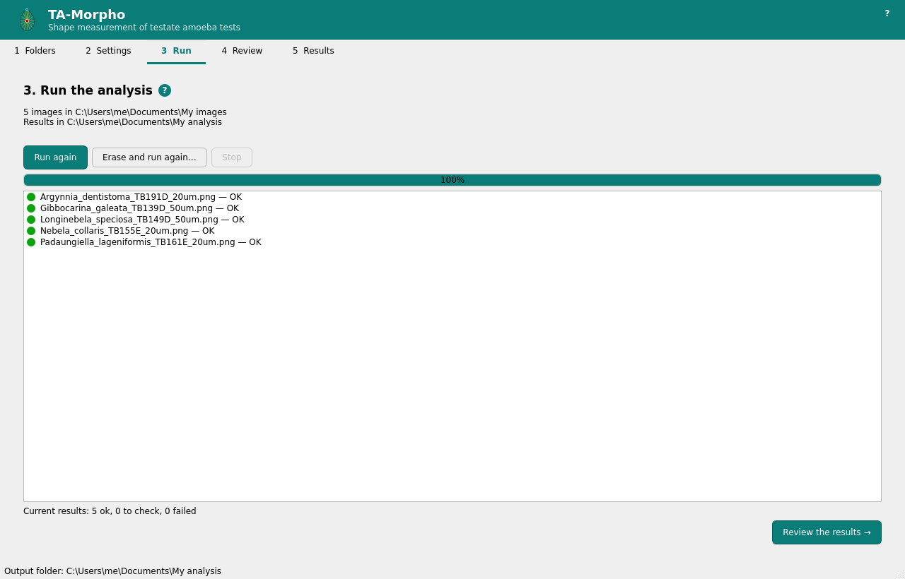
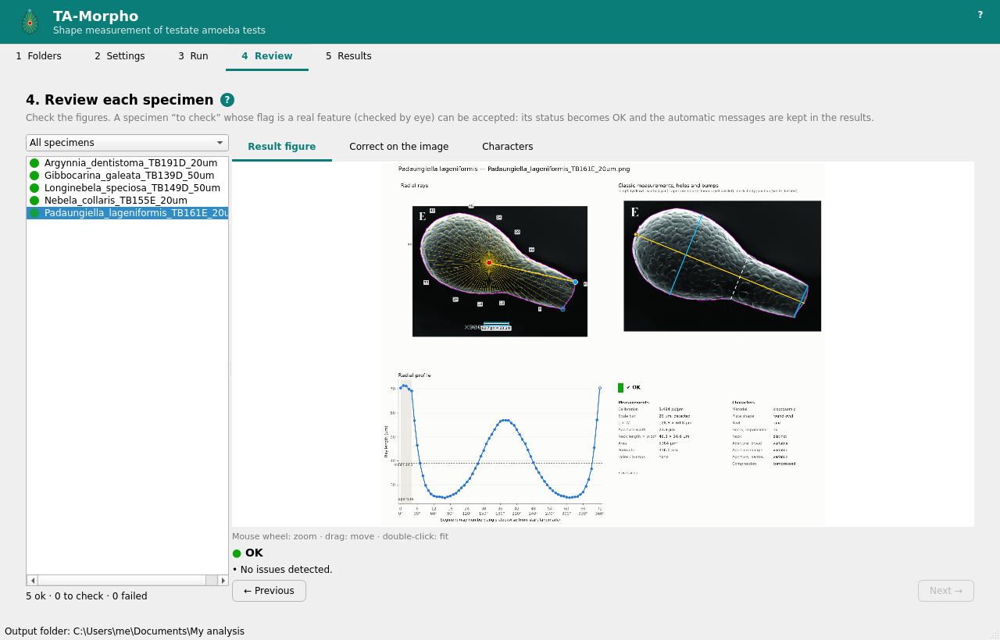
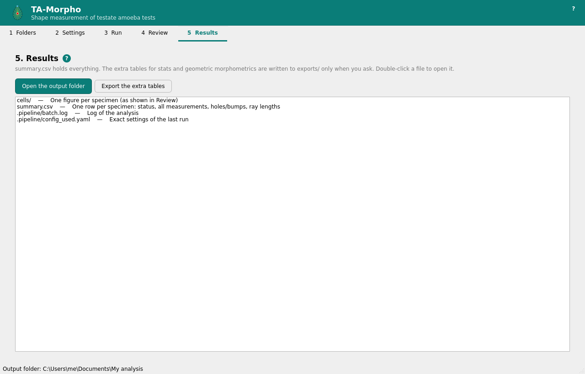
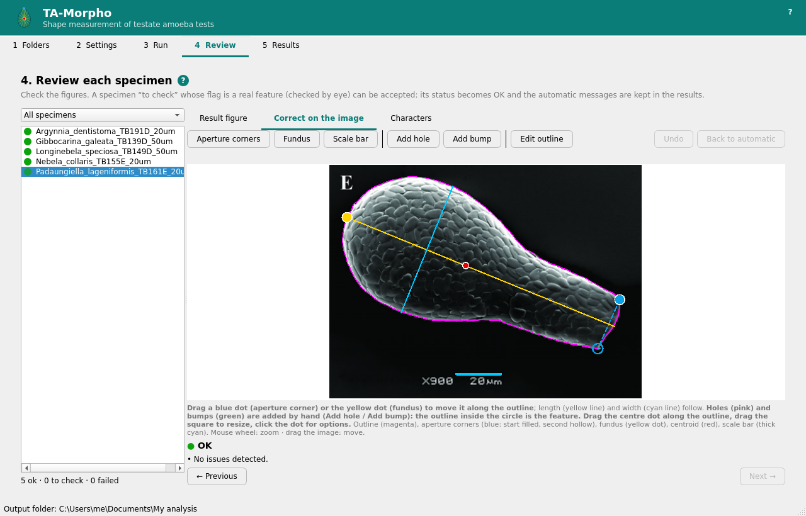
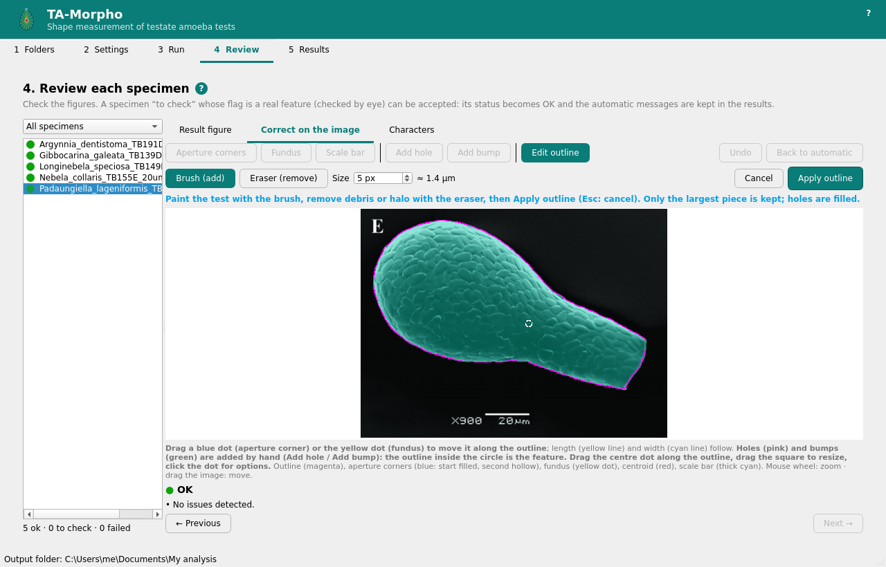
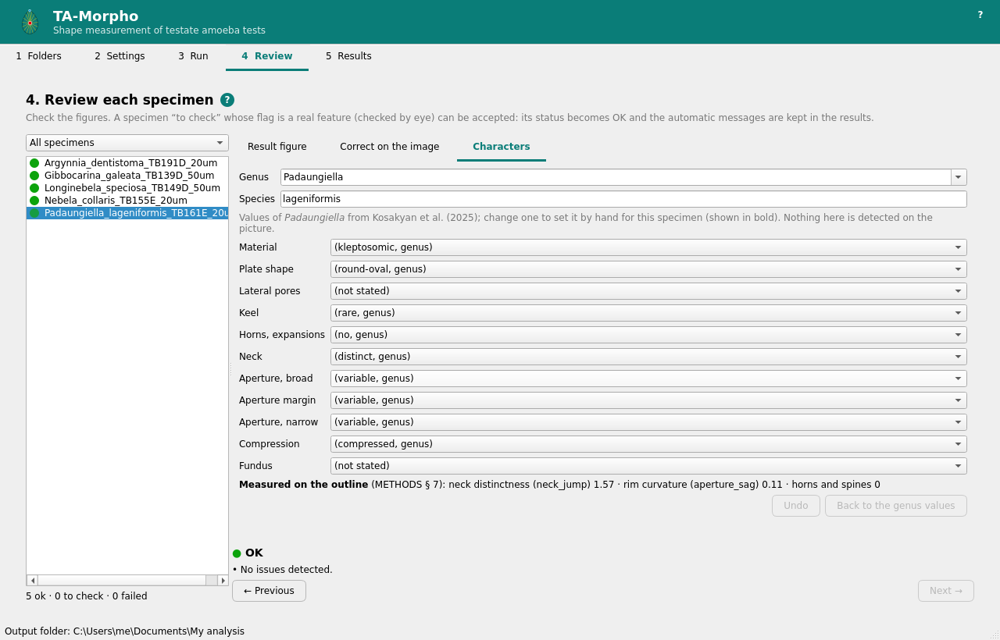

# TA-Morpho: user guide

Measure the shape of testate amoeba tests from microscope pictures, with no
programming. This guide covers the installation, a complete analysis and the
correction tools. The method itself is described in [METHODS.md](METHODS.md).

The screenshots show the SEM picture of *Padaungiella lageniformis* from
Todorov & Bankov (2019, CC BY 4.0), one of the validation pictures in
[`data/validation`](../data/validation).

## 1. Installation

Download the installer for your computer from the
[Releases](https://github.com/DavidSinger85/TA-Morpho/releases) page
(latest version → "Assets").

| Computer | File |
|---|---|
| Windows 10 / 11 | `TA-Morpho-<version>-Windows-setup.exe` |
| Mac with Apple Silicon (M1, M2, M3…) | `TA-Morpho-<version>-macOS-AppleSilicon.dmg` |
| Mac with an Intel processor | `TA-Morpho-<version>-macOS-Intel.dmg` |

(On a Mac, Apple menu → About This Mac shows "Chip: Apple M…" or "Processor: Intel".
The Mac program needs macOS 14 Sonoma or later.)

**Windows.** Run the setup file. It installs for your user only, so no
administrator rights are needed. The program is not signed with a paid
certificate, so Windows may show "Windows protected your PC": click **More
info**, then **Run anyway**. This happens only once.

**Mac.** Open the `.dmg` file and drag **TA-Morpho** to the Applications
folder. The first time, macOS may say the app "cannot be opened because it is
from an unidentified developer": right-click (or Ctrl-click) the app in
Applications → **Open** → **Open**. If macOS only offers to move it to the
bin, open System Settings → Privacy & Security and click **Open Anyway** next
to the message about TA-Morpho. This happens only once.

The program needs about 600 MB of disk space and works offline: your pictures
never leave your computer.

## 2. Prepare your pictures

- One test per picture, seen in broad view; PNG, JPG or TIFF (8 or 16 bits).
- A horizontal scale bar in the picture.
- Keep a margin of plain background around the test and around the scale bar:
  a bar that touches the edge of the picture is not detected, and a test that
  touches it is flagged.
- Put the pictures of one analysis in one folder (pictures in subfolders are
  not read).
- Name the files so that the taxon and the scale bar length can be read:
  `Nebela_collaris_20um_01.tif` (genus, species, bar length, specimen number)
  or `20 Nebela collaris.png` (bar length first). `sp`, `sp2` and `cf.`/`aff.`
  (`Nebela_cf.collaris_20um`, or `Nebela_cf_collaris_20um`) are accepted. A
  file whose name does not follow this pattern is still analysed, but flagged
  "To check"; without a bar length in the name, the default bar length
  (Settings) is used.
- A picture without a scale (a drawing, for example) is measured in pixels:
  the ratios are valid, the µm values are left empty. Draw the scale on the
  picture (section 4) if you know it.

## 3. A complete analysis

The program guides you through five steps, shown as tabs at the top. The
**?** buttons explain each page and each setting.

### Step 1: Folders

Click **Browse…** next to *Images* and choose the folder with your pictures
(the number found is shown), then choose an **Output** folder for the results.
Use a new, empty folder for a new analysis. To continue an earlier analysis,
choose its output folder again: your settings and corrections are kept there.
The picture folder is only read, never modified.

You can also paste a folder path copied from your file explorer and press Enter.

### Step 2: Settings

The defaults suit most pictures. Click the **?** next to a setting to read what
it does. **Show advanced settings** lists every setting of the method;
**Reset to defaults** restores them. The settings are saved with the analysis,
so it can always be reproduced.

### Step 3: Run

Click **Run analysis**. Each picture appears with its status as soon as it is
done (about 1–2 seconds per picture). **Stop** cancels the run after the
current picture: the results of the previous complete run are kept unchanged.

**Run again** analyses every picture again with your corrections (use it after
changing the settings or adding pictures). **Erase and run again…** removes all
results and every correction made by hand, then analyses every picture
automatically (a backup of the corrections is kept in `.pipeline/backups`;
only the 3 most recent backups are kept).

Close `summary.csv` in other programs while the program works: on Windows, a
file open in Excel cannot be replaced. A finished run then waits until you
close it and click **Retry** (nothing is analysed again), and a correction is
saved at once while `summary.csv` catches up at the next change, or when the
analysis is opened again.

### Step 4: Review

Every specimen has a figure: the outline and the rays (top left), the classic
measurements with the holes and bumps (top right), the radial profile, the
measurements and the characters of the specimen (bottom). Zoom with the mouse
wheel, double-click to fit.

The coloured dot gives the status:
- green **OK**;
- orange **To check**: something unusual was found (the reason is written
  under the figure; [section 5](#what-the-to-check-messages-mean) explains
  each message). If it is a real feature of the specimen (you checked by
  eye), type an optional note and click **Accept after visual check**. The
  status becomes OK and the original message is kept in the results;
  **Undo acceptance** cancels it;
- red **Failed**: the specimen could not be measured (see the message, and
  the corrections below).

Use the list above the specimens to show only those to check, failed or OK.

### Step 5: Results

**Open the output folder**, or double-click a file to open it (CSV files open
in your spreadsheet program). The main files:

| File | Content |
|---|---|
| `summary.csv` | one row per specimen: status, all measurements (length, width, aperture, neck, area, perimeter, ratios…), holes and bumps, ray lengths |
| `cells/` | the figure of every specimen, and its corrections, if any |
| `.pipeline/config_used.yaml`, `.pipeline/batch.log` | the exact settings of the last run, and its log |

The extra tables below are written to `exports/` only when you click **Export
the extra tables**. Once written, they are kept up to date: a correction only
marks them out of date (to stay fast), and they are rewritten when you open
them or the output folder from this page, when you close the program or change
folders, and at the next run.

| File | Content |
|---|---|
| `exports/profiles_long.csv` | every ray of every specimen, one row per ray |
| `exports/outline_profile.csv`, `exports/outline_coordinates.tps`, `exports/outline_sliders.csv` | the outline points, also for geometric morphometrics in R (geomorph) |
| `exports/outline_features.csv` | every hole and bump you added |

Every column is described in [DATA_DICTIONARY.md](DATA_DICTIONARY.md).

**In a spreadsheet.** The CSV files use commas between columns and a point as
the decimal mark. If your spreadsheet uses a decimal comma (e.g. French or
German settings), import the file (in Excel: Data → From Text/CSV) and choose
"comma" and the point as decimal mark, instead of double-clicking it. Save your
own changes under another name: never save over the files of the output
folder, in particular `cells/<picture>.csv`, which hold your corrections
(change those in the program).

## 4. Correcting a specimen

In **Review**, open the tab **Correct on the image**. The original picture is
shown with what the program found: the outline (magenta), the aperture corners
(blue: the start point filled, the other hollow), the fundus (the end of the
test opposite the aperture; yellow dot), the
length (yellow line) and the width (cyan line), the centroid (red), the scale
bar (thick cyan), and the holes (pink) and bumps (green) you added. Holes and
bumps are not detected automatically: add the ones you want measured. They are
measured in µm and placed from the aperture, so **Add hole** and **Add bump**
are available once the picture has a scale and an aperture.

Every correction analyses the picture again at once. **Undo** cancels the last
change (also an acceptance). Undo works only while the analysis stays open:
the steps are kept in memory, so after closing the program or opening another
folder the earlier changes cannot be undone. **Back to automatic** removes the
corrections drawn on this picture (outline, aperture corners, fundus, scale bar,
holes and bumps); an acceptance and the genus, species and characters set by
hand are kept.

| What is wrong | What to do |
|---|---|
| An aperture corner is misplaced | Drag the blue dot along the outline. The length and width lines follow while you drag. |
| No aperture was found | **Aperture corners**, then click the two corners on the outline (any order). |
| The fundus (aboral end) is misplaced | Drag the yellow dot along the outline, or **Fundus** and click it on the outline. |
| The scale is wrong or missing | **Scale bar**, drag from one end of the bar to the other, then type its length in µm. |
| A hole or bump should be measured | **Add hole** or **Add bump**, click its centre on the outline, then adjust the circle. |
| A hole or bump is badly placed or sized | Drag its centre dot along the outline, or drag the small square on its circle: the outline inside the circle is the feature, and its depth or height and its width are measured there. |
| A hole or bump should not be there | Click its centre dot → **Remove this hole** / **bump**. |
| The outline includes debris or a halo, or misses part of the test | **Edit outline** (below). |

Changes made by hand are recorded next to each figure (`cells/<picture>.csv`)
and marked in the results (for example `landmark_source = manual`; the
`corrections` column lists them all), so it is always visible what was
automatic and what was corrected.

### Editing the outline

Click **Edit outline**: the test appears as a translucent layer. Paint the test
with **Brush (add)**, remove debris or a halo with **Eraser (remove)**, and set
the brush size (in pixels; its size in µm is shown next to it). Then click
**Apply outline**, or **Cancel** (Esc). Only the largest piece is kept, and
holes inside the test are filled.

### Genus and characters

The tab **Characters** shows the genus and species (read from the file name)
and the diagnostic characters of the specimen. When the genus is one of the 14
genera of the monograph (Kosakyan et al. 2025), each character starts with the
genus's value, shown in brackets; hover over it to read the monograph's note
and page. Nothing here is detected on the picture.

- To correct the genus, choose it in the list (or type another name); the
  characters then follow the new genus. Type the species in its field.
- To set a character for this specimen (e.g. a keel seen on it), choose the
  value in its list: it is shown in bold and recorded as a correction. Choose
  the first line, in brackets, to go back to the genus's value.
- **Undo** cancels the last change; **Back to the genus values** removes the
  characters set by hand (**Back to automatic** in the correction tab keeps
  them).

The characters are shown on the figure and given in `summary.csv` (columns
`ch_…`; `characters_by_hand` lists those set by hand). The three characters
measured on the outline (neck distinctness, rim curvature, horns and spines)
are shown below the list.

## 5. Questions

**Where are my results?** In the output folder chosen in step 1. Copy the
whole folder to keep or share an analysis; opening it again in the program
restores the settings and corrections.

**Can I add pictures later?** Add them to the picture folder and click **Run
again** (step 3): all pictures are analysed, with your corrections.

**The analysis did not run: a correction file or a setting cannot be used.**
The message names the file or the setting and the problem. A correction file
edited in a spreadsheet is the usual cause (see "In a spreadsheet", section 3):
correct it, or delete it to drop the corrections of that picture.

### What the "To check" messages mean

Each message starts with the step that raised it. When the figure shows that
all is right, accept the specimen (step 4); otherwise correct it (section 4).

| Message (beginning) | What it means | What to do |
|---|---|---|
| file name: no bar length (e.g. '25um') in file name | The default bar length of the Settings (25 µm) was used. | Rename the file with its bar length (`_20um`), or draw the scale (**Scale bar**). |
| file name: bar length … outside 5-500 µm | An unusual bar length was read from the name. | Check the name. |
| file name: file name does not start with Genus species | The taxon was not read: genus and species are empty. | Rename the file, or set the genus and species in **Characters**. |
| calibration: No scale-bar-shaped object found | No bar found (it touches the edge, is vertical, faint, or absent): every µm value is empty (also the "no calibration" messages that follow). | Draw the scale (**Scale bar**). |
| calibration: N bar candidates | Several bar-like objects; the longest was used. | Check the cyan bar on the figure; if wrong, draw the scale. |
| segmentation: wall neither clearly darker nor lighter … | The program could not tell a light from a dark background. | Check the outline; correct it with **Edit outline**. |
| segmentation: another object in the image … was left out | A second object (another test, debris) is in the picture. | Check that the right object was measured. |
| segmentation: object touches image border; straight outline segment … (image cropped?) | The test touches or is cut by the picture edge. | If the outline is right, accept; otherwise use an uncropped picture. |
| segmentation: area fraction … outside | The object is very small or very large in the picture. | Check the outline. |
| landmark: no aperture … start = outline point furthest from centroid | No aperture was found (round or unclear test): length and width are measured along the principal axis instead; no outline profile, no holes and bumps. | Set the **Aperture corners**; for a really round test, accept. |
| landmark: … aperture taken as the closest pair of sharp corners | The aperture is uncertain. | Check the blue dots; drag them if they are wrong. |
| landmark: test cut by the image border (failed) | The aperture may be outside the picture. | Set the aperture corners by hand, or use an uncropped picture. |
| rays: N rays cross the outline more than once | The outline folds back (curved neck, horns): the outermost crossing was used. | Usual for such shapes: check and accept. |
| footprint: fundus set by hand on the aperture side | The fundus you set is on the wrong side. | Move the yellow dot to the end opposite the aperture. |
| holes/bumps: the hole/bump added at … can no longer be measured | The outline changed under it. | Move it along the outline, or remove it. |
| figure: the cell figure could not be drawn | The measurements are kept, but there is no figure. | Report it (below). |

**The program is slow to start the first time.** It prepares its fonts once;
later starts are faster.

**Something does not work.** Look at `.pipeline/batch.log` in the output
folder, and report the problem on the
[Issues](https://github.com/DavidSinger85/TA-Morpho/issues) page, with the
picture if you can share it.

## Reference

- Todorov M., Bankov N. (2019). An atlas of *Sphagnum*-dwelling testate amoebae
  in Bulgaria. Advanced Books, Pensoft. https://doi.org/10.3897/ab.e38685
